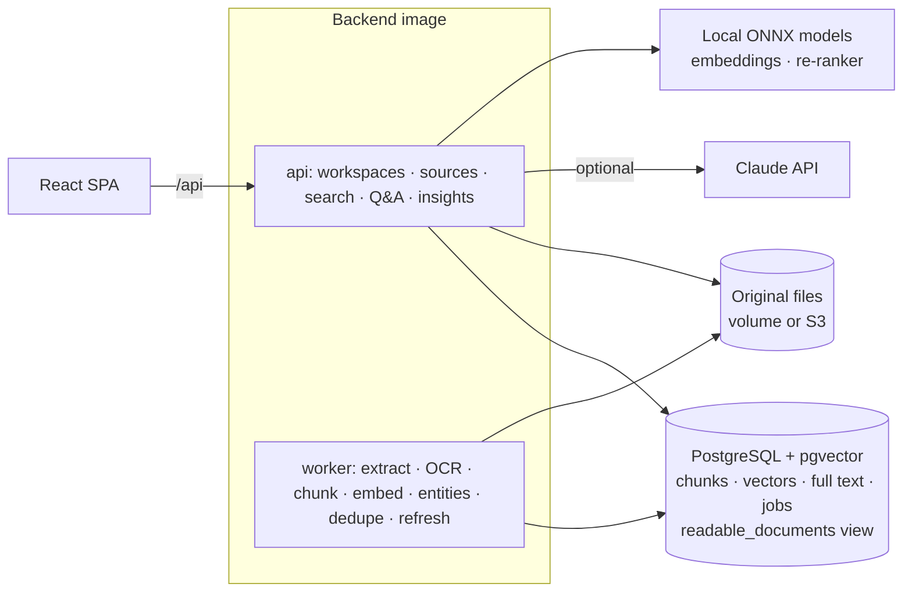

# AI Research & Knowledge Engine

A knowledge platform for teams: build shared knowledge bases from files, ZIP archives and web pages,
search them with hybrid keyword + semantic retrieval and cross-encoder re-ranking, and ask questions
that are answered **only from the sources, with citations**, or with an honest "not enough information".

**Stack:** Python 3.13 · FastAPI · PostgreSQL 16 + pgvector · local ONNX models (bge-small embeddings,
MiniLM cross-encoder re-ranker) · Claude API (optional) · React 18 + TypeScript · Docker ·
Terraform (AWS ECS + RDS + S3, not applied) · GitHub Actions

## The problem

Company knowledge is scattered across wikis, PDFs, policies, research notes and web pages. Keyword search
misses documents that use different words, and AI assistants that are not grounded in the organisation's
own sources invent answers. Teams lose hours searching, and act on outdated or contradictory information
without noticing.

## What this engine does

- **Shared knowledge bases with permissions.** Workspaces have owners, editors and readers. Knowledge
  bases in a workspace you don't belong to are invisible: not in search, not in answers, not in citations.
- **Ingests anything text-based.** PDF, Word, Markdown, HTML, plain text and scanned images (OCR); whole
  ZIP archives; single web pages fetched safely (SSRF-protected). Unchanged content is not re-processed.
- **Finds the right passage even when the wording differs.** Hybrid keyword + vector search, then a
  cross-encoder re-ranks the top candidates and reports a relevance score per passage.
- **Answers with citations, or says it doesn't know.** Every sentence links to the exact passage. If the
  best evidence isn't relevant enough, the answer is "not found" instead of a guess.
- **Warns when sources disagree.** If cited sources give different values (an old policy says 30 days,
  the current one 14), the answer says so and names both.
- **Shows the shape of the knowledge.** Concept graph, topic clusters, duplicate sources, and
  freshness/reliability indicators for every source.
- **Measures itself.** Retrieval quality and answer quality are evaluated separately on a labelled benchmark.

**Who it is for:** research, support and operations teams that rely on a large, changing body of documents.

> **Data notice.** The demo and the evaluation use a seeded **synthetic** corpus about a fictional company
> (37 sources, 77 labelled questions). The numbers below describe that corpus, not every real knowledge base.

## Architecture



How a question is answered:

1. **Entity filter.** If the question names something specific ("INC-2030", "Ledger Service"), only sources
   that mention it are eligible. Unknown names → "not found" without calling any model.
2. **Hybrid retrieval** inside the caller's readable knowledge bases (access control is part of the SQL):
   PostgreSQL full-text search and pgvector similarity, fused with Reciprocal Rank Fusion.
3. **Re-ranking.** A cross-encoder reads the question with each of the top 15 passages and re-orders them.
4. **Relevance gate.** If the best passage's re-ranker relevance is below 0.2, answer "not found".
5. **Answer** with Claude (when configured) or the offline extractive answerer (quotes source sentences).
   Uncited answers are withheld.
6. **Cross-source check.** Rule-based comparison of quantities in the cited passages.

The full design and the changes made during implementation are in [docs/DESIGN.md](docs/DESIGN.md).

## Results (from [eval/reports/evaluation.md](eval/reports/evaluation.md))

**Retrieval** (does the right source come back?), document level, 70 answerable questions:

| Mode | Recall@5 | MRR | nDCG@10 |
|---|---|---|---|
| Keyword only | 97.1% | 0.891 | 0.918 |
| Vector only | 100% | 0.948 | 0.957 |
| Hybrid (RRF) | 100% | 0.917 | 0.934 |
| **Hybrid + re-ranking** | **100%** | **1.000** | **1.000** |

Re-ranking puts the correct source first for every question. It costs about 2.6 s per query on a
laptop CPU (hybrid alone: ~0.1 s), so it can be switched off per query.

**Answers** (full pipeline, offline extractive answerer, each question asked as its user):

| Metric | Result |
|---|---|
| Fact accuracy on answerable questions | 77.1% (89% on factual, 54% on paraphrased questions) |
| False refusals | 1.4% |
| Citation precision | 99.3% |
| Correct "not found" on unanswerable questions | 100% |
| Contradicting sources flagged | 100% (the old vs. current refund policy) |
| **Answers citing a source the asker can't read** | **0** |

The relevance threshold and answer rules were tuned on this same benchmark, so these figures are
optimistic for unseen corpora (see [known limitations](docs/known-limitations.md)).

## Quick start (Docker)

```bash
cp .env.example .env            # set the CHANGE_ME values
docker compose up -d --build
docker compose run --rm api python -m app.cli demo
```

Open http://localhost:8080 and sign in as `erin@example.com` (engineering editor),
`fiona@example.com` (finance) or `admin@example.com`, password = `RKE_DEMO_PASSWORD` from `.env`.
API docs: http://localhost:8000/api/docs.

## Development

See [docs/DEVELOPMENT.md](docs/DEVELOPMENT.md). In short: `make lint`, `make test`, `make evaluate`.

## Documentation

| Document | Contents |
|---|---|
| [docs/DESIGN.md](docs/DESIGN.md) | Requirements, architecture, data model, API, evaluation and security design; changes during implementation |
| [docs/AI_CARD.md](docs/AI_CARD.md) | What the models do, how answers are grounded, when not to trust them |
| [docs/OPERATIONS.md](docs/OPERATIONS.md) | Runbook: processing problems, wrong answers, access questions, web sources, backups |
| [docs/AWS_DEPLOYMENT.md](docs/AWS_DEPLOYMENT.md) | AWS architecture, cost estimate, deploy, rollback and teardown |
| [docs/known-limitations.md](docs/known-limitations.md) | What it doesn't do, and why |
