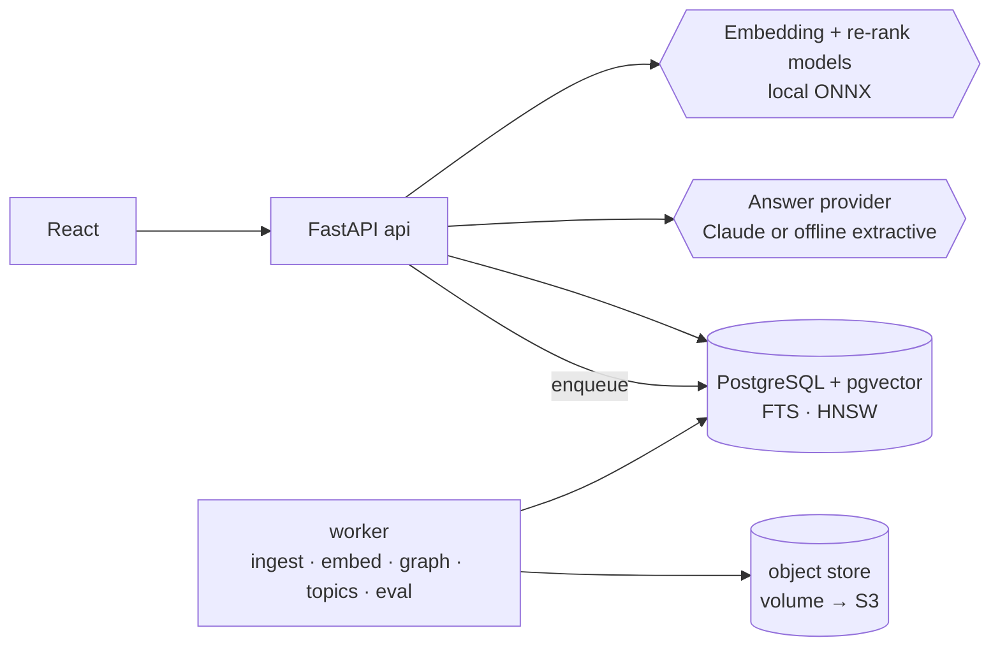

# AI Research & Knowledge Engine — Design Document (v1.0)

Status: **Implemented.** Section 10 lists where the implementation differs from this design, and why.

## 0. How this differs from Intelligent Document AI

Intelligent Document AI is about *understanding individual documents* (OCR, classification, field extraction,
per-document Q&A). This project is about *knowledge across large collections*:

| Intelligent Document AI already does | This engine adds |
|---|---|
| Hybrid search + cited answers over one user's documents | **Knowledge bases** shared by **workspaces** with roles (owner / editor / reader) |
| Per-document processing | **Ingestion connectors** (upload, URL fetch with allow-list, bulk ZIP of Markdown/HTML/PDF/TXT) and **re-ingestion on change** |
| Fixed retrieval | **Two-stage retrieval**: hybrid recall (BM25 + vector, Reciprocal Rank Fusion) → **cross-encoder re-ranking**, with **source relevance scores** shown to users |
| Single-document answers | **Cross-document answers** that say which sources agree or conflict |
| — | **Knowledge graph** of entities and relations, **topic discovery**, **near-duplicate** detection, **freshness** tracking, **source reliability** indicators |
| Answer accuracy checks | **Retrieval evaluated separately from answers** (recall@k, MRR, nDCG vs. answer groundedness/citation precision) on a labelled benchmark |

Reused from the AI Predictive Maintenance, Intelligent Document AI and Fraud Detection platforms: core (config, auth, RBAC, errors, logging), PostgreSQL job queue, CI, Docker, Terraform skeleton, the React scaffold, and the Intelligent Document AI platform's text extraction and provider interfaces.

## 1. Requirements

### 1.1 Users and roles
- **Platform admin**: users, system settings, all audit logs.
- **Workspace roles** (per workspace): **owner** (manage members and knowledge bases), **editor** (add/remove sources), **reader** (search and ask).
- Access is enforced at query time on every chunk: a user only ever retrieves chunks from knowledge bases in workspaces they belong to. Tested with a cross-workspace leakage test.

### 1.2 Functional requirements (MVP)
| ID | Requirement |
|---|---|
| F1 | Login, JWT, refresh rotation (reused) |
| F2 | Workspaces and membership with roles |
| F3 | Knowledge bases inside workspaces; settings: chunk size/overlap, embedding model, language |
| F4 | Ingest: file upload (PDF, DOCX, TXT, MD, HTML), ZIP bulk, URL fetch (allow-listed domains, size/time limits, no private IPs) |
| F5 | Normalise → structure-aware chunking (headings, paragraphs; token-based with overlap) → embeddings → index |
| F6 | Content hashing: unchanged sources are skipped on re-ingestion; changed sources create a new version |
| F7 | Search: keyword (PostgreSQL full-text), semantic (pgvector HNSW), hybrid (RRF), optional re-ranking |
| F8 | Ask: RAG answer with inline citations `[1]` linked to passages; **refuses** when retrieval support is insufficient |
| F9 | Conversations and search history per user |
| F10 | Source viewer with the cited passage highlighted |
| F11 | Evaluation module: labelled question set, retrieval metrics, answer metrics, report |

### 1.3 Advanced requirements (built)
A1 Cross-document synthesis (agreement/conflict between sources) · A2 Knowledge graph (entities, co-occurrence relations, graph view) · A3 Topic discovery (embedding clustering + keyword labels) · A4 Near-duplicate detection (MinHash on chunks) · A5 Freshness (source age, "stale" flag, re-check URL sources) · A6 Source reliability indicator (rule-based, labelled as such) · A7 Collaborative workspaces (shared KBs, saved answers with notes).

### 1.4 Non-functional
Reproducible `docker compose up` with a demo corpus; p95 search < 300 ms on the demo corpus (measured); every answer stores retrieved chunks, scores and model/prompt version for audit; works fully offline (local embedding model + extractive answerer); Claude used when an API key is configured.

## 2. Architecture

Modular monolith (`api` + `worker`) from one image, PostgreSQL 16 with **pgvector**, as in the AI Predictive Maintenance, Intelligent Document AI and Fraud Detection platforms.

### 2.1 Pipelines (separate by design)
1. **Ingestion**: fetch/receive → validate (type, size, URL allow-list, SSRF guard) → extract text (reuse P2) → normalise → hash → chunk → embed → write chunks + vectors + FTS → entity extraction → near-duplicate signatures. Each stage is a job step with retries; failures are visible per source.
2. **Retrieval**: permission filter (workspace → KB ids) → BM25 top-50 + vector top-50 → RRF → re-rank top-20 with a cross-encoder → top-k with scores.
3. **Generation**: prompt with numbered passages → answer with citations → **post-check**: every sentence must cite a retrieved passage, citations must exist; unsupported sentences are removed or the answer becomes "not enough information in the knowledge base".

### 2.2 Model choices
| Need | Choice | Why |
|---|---|---|
| Embeddings | `BAAI/bge-small-en-v1.5` (384-d) via ONNX Runtime (fastembed) | Small, strong, CPU-friendly, no external API |
| Re-ranking | `Xenova/ms-marco-MiniLM-L-6-v2` cross-encoder (ONNX) | Big precision gain for small cost |
| Answers | Claude (`claude-sonnet-5-5`) when `RKE_ANTHROPIC_API_KEY` is set; otherwise extractive answerer | Demo works offline; output labelled with its source |
| Entities | spaCy-free rule + capitalised-phrase extractor with a curated stop-list; optional Claude extraction | No heavy dependency |

## 3. Data model (abridged)
`users`, `refresh_tokens`, `workspaces`, `workspace_members(role)`, `knowledge_bases`, `sources(kind, uri, title, content_hash, version, fetched_at, published_at, reliability, status)`, `chunks(source_id, kb_id, ord, text, heading_path, tokens, embedding vector(384), tsv tsvector, minhash bytea)`, `entities`, `entity_mentions`, `entity_edges(weight)`, `topics`, `chunk_topics`, `conversations`, `messages(answer, citations jsonb, retrieval jsonb, provider)`, `search_history`, `saved_answers`, `eval_sets`, `eval_items`, `eval_runs(metrics jsonb)`, `jobs`, `audit_log`.

Indexes: HNSW on `chunks.embedding` (cosine), GIN on `chunks.tsv`, btree on `(kb_id)`. `kb_id` is denormalised on chunks so the permission filter is a single indexed predicate.

## 4. API (v1, abridged)
`/auth/*` · `/workspaces` (+ `/members`) · `/knowledge-bases` (+ `/sources`, `/sources:url`, `/sources:zip`) · `/sources/{id}` (+ `/chunks`, `/reingest`) · `/search?q=&kb=&mode=hybrid|semantic|keyword&rerank=true` · `/ask` · `/conversations` · `/graph?kb=` · `/topics?kb=` · `/duplicates?kb=` · `/evaluation/sets`, `/evaluation/runs` · `/admin/*` · `/health/*`.

## 5. Evaluation (no fabricated numbers)
- **Benchmark**: a synthetic but realistic corpus (generated handbook/policy/research-note collection with known facts, contradictions and near-duplicates), plus a labelled question set: question → relevant chunk ids → reference answer facts, including unanswerable questions.
- **Retrieval metrics**: recall@5/10, MRR, nDCG@10 for keyword, semantic, hybrid and hybrid+re-rank.
- **Answer metrics**: groundedness (every claim supported by a cited passage), citation precision, fact recall vs. reference, correct refusal rate on unanswerable questions.
- All numbers written by `python -m app.cli evaluate` to `eval/reports/`.

## 6. Security
Workspace-scoped authorisation on every query (tested); URL ingestion: allow-list, HTTPS only, DNS resolved and private/loopback/link-local ranges blocked (SSRF), redirects re-checked, 10 MB / 15 s limits; uploads type-sniffed; ZIP: size, entry-count and path-traversal limits (zip-slip); prompt-injection hardening (retrieved text is quoted data, never instructions; system prompt states this); secrets from env / Secrets Manager; audit log of membership and KB changes.

## 7. Roadmap
M0 foundation (reuse) · M1 workspaces/KBs/RBAC · M2 ingestion connectors + chunking + hashing · M3 embeddings + indexes · M4 hybrid search + re-rank · M5 RAG with citation post-check · M6 conversations/history · M7 graph, topics, duplicates, freshness, reliability · M8 evaluation benchmark + report · M9 frontend · M10 hardening, Docker, CI, Terraform (not applied), docs.

## 8. Key design decisions
1. Modular monolith + worker, PostgreSQL + pgvector (no separate vector DB).
2. Local ONNX embedding and re-ranking models; Claude optional for answers.
3. Workspace-level RBAC with KB scoping enforced in SQL.
4. Synthetic benchmark corpus with labelled questions; retrieval and answer metrics reported separately.
5. URL connector with strict SSRF protections; no crawling beyond the given URL.

---

## 10. Changes made during implementation

| Area | Design | Built | Why |
|---|---|---|---|
| Sources table | separate `sources` table | The proven `documents` / `document_versions` / `chunks` tables, with `kb_id`, source kind, URL, publication and fetch dates | Reuses a tested pipeline; a source *is* a document in a knowledge base |
| Access control | per-chunk filter | One database view, `readable_documents`, derived from workspace membership; every query joins it | One definition of "may read" for search, Q&A, citations and history |
| Relevance gate | vector similarity | Cross-encoder relevance of the best passage (≥ 0.2) when re-ranking is on | Measured: answerable questions scored ≥ 0.37, off-topic ones ~0.0; vector similarity refused many paraphrases |
| Offline answers | best-matching sentences | Headings and title lines excluded; value questions prefer sentences with numbers; cross-encoder only as a tie-breaker | Measured: the MiniLM re-ranker is poorly calibrated on single sentences. Fact accuracy rose from 56% to 77%, false refusals fell from 16% to 1% |
| Identifier detection | tokens with digits | Ordinals ("95th", "1st") excluded | "95th percentile" was treated as a name and caused refusals |
| Re-rank candidates | top 20 | top 15 | Hybrid recall@10 is already 100%; fewer candidates halves CPU time |
| Entities | rule extractor, optional Claude | Concept patterns (acronyms, multi-word names) added to the inherited extractor | Gives the knowledge graph useful nodes without a heavy NLP dependency |
| Topics | embedding clustering | k-means on mean chunk embeddings computed in PostgreSQL (`avg(embedding)`), TF-IDF labels | No extra ML dependency; deterministic |
